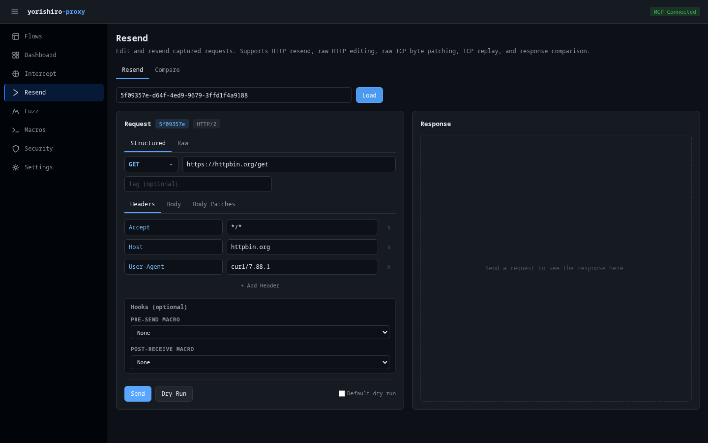

# Resender

The Resender page lets you edit and resend captured requests over HTTP, WebSocket, gRPC, and raw TCP. Each send goes through the matching typed MCP tool (`resend_http`, `resend_ws`, `resend_grpc`, or `resend_raw`).

## Loading a flow

To start resending, you need to load a captured flow:

1. Enter a flow ID in the input field (or navigate from the Flows page via the **Resend** button)
2. Click **Load** (or press Enter)

The editor populates with the flow's request data. The interface adapts based on the flow's protocol -- HTTP flows show an HTTP editor, WebSocket flows show a frame editor, gRPC flows show a gRPC editor, and TCP flows show a TCP editor.

Two page mode tabs sit at the top of the page:

- **Resend** -- The editor described on this page
- **Compare** -- Response comparison. This view is currently suspended and only shows a placeholder; use the **Resend** tab and compare responses in the send history instead

## HTTP mode

When you load an HTTP or HTTPS flow, the editor presents a split-panel layout with the request editor on the left and response viewer on the right.

### Editor modes

Two editor mode tabs let you switch between:

- **Structured** -- Form-based editor with separate fields for method, URL, headers, and body
- **Raw** -- Full raw HTTP message editor for direct text editing

For HTTP/2 and gRPC flows, the structured editor works normally while the raw editor reconstructs an HTTP/1.1 representation with a notice about the downgrade.

### Structured editor

The structured editor provides:

#### Method and URL

A dropdown for the HTTP method (GET, POST, PUT, DELETE, PATCH, HEAD, OPTIONS) and a text input for the URL.

#### Tag

An optional tag field to label the resent request for later identification.

#### Request tabs

Three tabs organize the request editing:

- **Headers** -- Key-value editor for request headers. Add, modify, or remove individual headers.
- **Body** -- Textarea for the request body content.
- **Body patches** -- Patch editor for applying targeted modifications to the request body without rewriting it entirely. See [Body patches](#body-patches).

#### Body patches

Each patch row has a mode selector, and the two modes are mutually exclusive:

| Mode | Fields | Description |
|------|--------|-------------|
| **JSON path + value** | JSON path (e.g., `$.path.to.field`), new value (JSON) | Replace the value at a JSON path |
| **Regex + replace** | Regex pattern, replace string | Replace every regex match in the body |

Switching modes clears the row's fields. A row with an empty `json_path` (or empty `regex` in regex mode) shows an inline validation error, and the **Send** button stays disabled until every row is valid.

#### Hooks

When macros are defined, a **Hooks** section appears. It is currently **suspended**: the typed `resend_http` tool doesn't accept hooks yet, so the editor is shown greyed out and its values are not sent. To run a macro around a resend, call the [`macro`](../tools/macro.md) tool directly or use `fuzz_http` hooks.

#### Actions

- **Send** -- Sends the request via `resend_http`. Disabled while any body patch is invalid
- **Default dry-run (suspended)** -- Disabled checkbox. The typed resend tools have no dry-run mode

### Raw editor

The raw editor provides:

- **Target address** -- `host:port` field (e.g., `example.com:443`)
- **TLS** -- Checkbox to enable TLS for the connection
- **Tag** -- Optional tag field
- **Raw HTTP text** -- Full editable HTTP message including request line, headers, and body
- **Send Raw** button (the dry-run checkbox is suspended here as well)

### Response viewer

The right panel displays the response after sending:

- Status code badge (color-coded by class)
- Duration in milliseconds
- Response headers and body with syntax highlighting

When no response is available yet, a placeholder message is shown.

## WebSocket mode

When you load a WebSocket flow, the editor shows a single-frame editor that sends through `resend_ws`:

- **Target** -- `host:port`. Optional; recovered from the flow when left blank
- **Scheme** -- `wss` or `ws`
- **Path** -- The upgrade path (e.g., `/ws/path`)
- **Opcode** -- `text`, `binary`, `ping`, `pong`, or `close`
- **FIN** -- Prefilled from the loaded flow's first client frame (`ws_fin` metadata), so a fragmented frame (FIN=0) is not silently resent as FIN=1
- **Compressed** -- Mark the frame as per-message-deflate (RFC 7692) compressed. Shown for `text` and `binary` only
- **Payload** -- Frame payload, as `text` or `base64`
- **Close code / close reason** -- Shown for `close` frames (code 1000--4999)

## gRPC mode

When you load a gRPC flow, the editor sends a unary call through `resend_grpc`:

- **Target** -- `host:port`. Optional; recovered from the flow when left blank
- **Scheme** -- `https` or `http`
- **Service** -- Fully qualified service name (`package.Service`)
- **Method** -- Method name
- **Message body** -- Plaintext message body. Proto-schema-aware editing is not available in the WebUI yet

## TCP mode

When you load a TCP flow, the editor switches to TCP mode with a different set of controls.

### TCP mode tabs

- **Resend Raw** -- Resend raw bytes with optional patches
- **TCP Replay** -- Replay all client messages in sequence

### TCP controls

- **Target address** -- `host:port` for the TCP connection target
- **TLS** -- Checkbox to enable TLS
- **Tag** -- Optional tag field

### Resend raw

In Resend Raw mode, two tabs are available:

- **Messages** -- Read-only list of original TCP messages showing direction (send/receive), size, and content
- **Raw Patches** -- Editor for applying byte-level patches to the raw TCP data before resending

Each raw patch row has a mode selector:

| Mode | Description |
|------|-------------|
| **Offset + Data (base64)** | Overwrite bytes at a byte offset with base64-encoded data |
| **Find/Replace (base64)** | Find and replace by base64-encoded bytes |
| **Find/Replace (text)** | Find and replace by plain text |

The offset field is validated as you type: it must be a non-negative integer, and an empty, fractional, or negative value shows an inline error and disables **Send Raw**. Only offset patches are sent to `resend_raw` (its `patches` parameter is offset-based); find/replace rows are kept in the editor but not applied.

Action: **Send Raw** (the dry-run checkbox is suspended).

### TCP replay

TCP Replay re-sends all client (send) messages in their original sequence to the target address. No patching is applied -- this mode is useful for reproducing the exact original interaction.

Action: **Replay All** button.

### Response viewer

The TCP response viewer shows the raw response data with byte count and duration.

## Send history

Below the editor, the **Send History** list shows resend operations recorded server-side, not just from the current browser session: it is backed by `query("flows")` filtered to `origin: "resend"`, so the list survives a browser reload and opening the WebUI on a different machine surfaces the same history. Each entry shows:

- Status code badge (`---` when there is no status, e.g. raw TCP)
- Protocol badge
- Method (or RAW/REPLAY indicator) and target URL or address
- Tag (if set)
- Duration
- Timestamp

Click an entry to open the corresponding flow on the [Flow detail](flows.md) page. The list pages server-side with **Prev** / **Next** buttons, so deep histories stay responsive.

## Related pages

- [Resender feature](../features/resender.md) -- Detailed resender documentation
- [resend_http](../tools/resend-http.md), [resend_ws](../tools/resend-ws.md), [resend_grpc](../tools/resend-grpc.md), [resend_raw](../tools/resend-raw.md) -- typed per-protocol resend MCP tools
